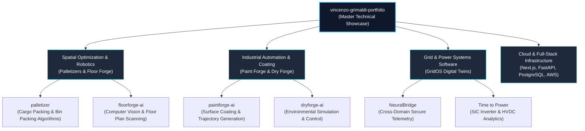

# ⚙️ vincenzo-grimaldi-portfolio

### **Master Technical Portfolio & Engineering Showcase**

*A comprehensive architectural reference uniting advanced robotics, spatial optimization, industrial automation, and full-stack software systems.*

[Explore Personal Surface](https://grimaldi.ca) • [Corporate Hub](https://engineeringgrimaldi.com) • [Electrical Depth](https://igrimaldi.engineering)

---

> *"The intersection of rigorous physical engineering and high-performance software architecture is where industrial transformation occurs."* — The core philosophy governing the systems, algorithms, and applications compiled within this repository.

---

## 🏛️ Ecosystem Architecture & Portfolio Context

The `vincenzo-grimaldi-portfolio` repository serves as the definitive technical showroom and implementation repository, complementing the broader Grimaldi digital ecosystem:

| Surface / Repo | Domain & Role | Primary Focus |
| --- | --- | --- |
| **`vincenzo-grimaldi-portfolio`** *(This Repo)* | Master Technical Showcase | Full-stack architecture, robotics, spatial optimization engines, and software systems |
| **`grimaldi.ca`** | Human & Narrative Layer | Biography, broader ambitions, writing, podcast, and direct contact navigation |
| **`engineeringgrimaldi.com`** | Corporate Umbrella | Parent hub for *Time to Power / Gridforge* and *NeuralBridge* |
| **`igrimaldi.engineering`** | Electrical Depth | High-voltage systems, traction power, SiC inverters, and physics-informed modeling |

---

## 🧬 Core Technical Domains & Systems

The portfolio architecture is structured around four primary technological pillars, bridging physical engineering constraints with modern distributed software patterns:

### 1. Spatial Optimization & Robotics (`palletizer`, `floorforge-ai`)

* **Algorithmic Packing**: High-performance bin-packing and multi-dimensional cargo optimization engines built for heavy industrial logistics and automated warehousing.
* **Computer Vision & Scanning**: `floorforge-ai` leverages spatial mapping, point-cloud processing, and geometric feature extraction to digitize physical environments and architectural layouts with high precision.

### 2. Industrial Surface Automation (`paintforge-ai`, `dryforge-ai`)

* **Robotic Trajectory Planning**: Advanced motion planning and surface coverage algorithms designed for automated coating, finishing, and treatment applications.
* **Environmental Control**: Simulation models for curing, drying dynamics, and thermal regulation in manufacturing workflows.

### 3. Grid & Power Systems Modeling (`GridOS`, `NeuralBridge`)

* **Digital-Twin Engineering**: Simulating high-voltage direct current (HVDC) distribution, silicon carbide (SiC) inverter efficiency, and microgrid transient stability.
* **Secure Data Exchange**: `NeuralBridge` protocols ensuring robust, low-latency, cross-domain telemetry and reinforcement learning feedback loops across mission-critical physical nodes.

### 4. Full-Stack Cloud & DevOps Infrastructure

* **Frontend Excellence**: High-performance, type-safe interfaces built with Next.js App Router, TypeScript, and Tailwind CSS.
* **Backend & Compute**: Resilient microservices powered by Python (FastAPI, NumPy, SciPy) and C++ for computationally intensive solvers.
* **Deployment & CI/CD**: Containerized via Docker, orchestrated with automated GitHub Actions pipelines, and deployed at the edge on AWS and Vercel.

---

## 🛠️ Technology Stack Breakdown

| Layer | Technologies & Frameworks | Architectural Purpose |
| --- | --- | --- |
| **Languages** | Python, C++, TypeScript, JavaScript | Balancing low-level system performance with rapid full-stack delivery |
| **Frontend & UI** | Next.js, React, Tailwind CSS | Server-side rendering, edge-optimized static generation, and interactive data visualization |
| **Backend & APIs** | FastAPI, Node.js, REST, WebSockets | Asynchronous high-throughput data ingestion and real-time state synchronization |
| **Data & Storage** | PostgreSQL, Prisma, Redis | Relational data integrity, spatial indexing, and low-latency caching |
| **Robotics & Math** | ROS 2, NumPy, SciPy, OpenFOAM (integration concepts) | Kinematic modeling, optimization solvers, and spatial computation |
| **DevOps & Tooling** | Docker, AWS, GitHub Actions, Linux (macOS/Ubuntu CLI) | Automated testing, continuous deployment, and containerized reproducibility |

---

## 🎯 Target Audience & Evaluation Guide

Designed for engineering directors, technical recruiters, system architects, and collaborators seeking deep visibility into production-grade codebases:

* **For Software Architecture & Full-Stack Implementations** → Review the repository's component hierarchy, state management patterns, and type safety standards.
* **For Robotics & Spatial Algorithms** → Inspect solver implementations, packing heuristics, and coordinate transformation pipelines.
* **For Enterprise & Industrial Synergy** → Cross-reference this technical portfolio with our corporate umbrella at [engineeringgrimaldi.com](https://engineeringgrimaldi.com) and electrical depth at [igrimaldi.engineering](https://igrimaldi.engineering).

---

## 📬 Contact & Professional Channels

* **Master Portfolio**: This repository (`vincenzo-grimaldi-portfolio`)
* **Personal Surface**: [grimaldi.ca](https://grimaldi.ca)
* **Corporate Hub**: [engineeringgrimaldi.com](https://engineeringgrimaldi.com)
* **Electrical Depth**: [igrimaldi.engineering](https://igrimaldi.engineering)
* **Direct Email**: [vincenzo@igrimaldi.engineering](https://www.google.com/search?q=mailto%3Avincenzo%40igrimaldi.engineering)
* **Location**: Frankfurt am Main, Germany

---

### **License & Intellectual Property**

Code: [MIT](https://www.google.com/search?q=LICENSE) • Proprietary Algorithms & Systems: All rights reserved.

*Engineered with mathematical precision and uncompromising software craftsmanship.*
